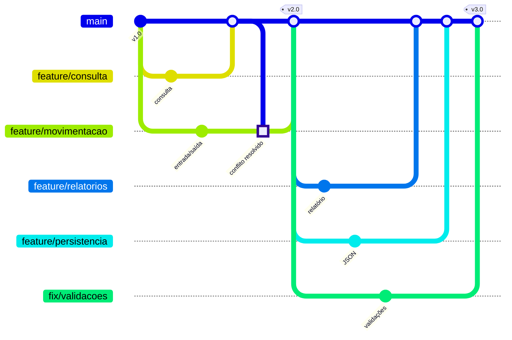

<h1 align="center">📦 Controle de Estoque</h1>

<p align="center">
  Sistema de terminal em Python para gerenciar o estoque de uma pequena loja<br>
  desenvolvido em equipe com <strong>Git</strong> e <strong>GitHub</strong>.
</p>

<p align="center">
  
  
  
  
</p>

<p align="center">
  <a href="#-sobre">Sobre</a> •
  <a href="#-funcionalidades">Funcionalidades</a> •
  <a href="#-como-executar">Como executar</a> •
  <a href="#-exemplo-de-uso">Exemplo</a> •
  <a href="#-fluxo-de-desenvolvimento">Fluxo Git</a> •
  <a href="#-equipe">Equipe</a>
</p>

---

## 📖 Sobre

O **Controle de Estoque** permite cadastrar produtos, registrar entradas e saídas, consultar itens, acompanhar o valor total do estoque e identificar produtos com estoque baixo. Os dados são salvos automaticamente em arquivo e carregados na próxima execução.

O projeto foi construído como trabalho prático da disciplina **Design Profissional**, na **Universidade Positivo**, com foco em **desenvolvimento colaborativo**. Cada funcionalidade foi feita em uma branch própria e integrada por Pull Request com revisão de outro integrante. Durante o processo, a equipe provocou e resolveu um conflito de merge real.

## ✨ Funcionalidades

| Opção | Funcionalidade | Descrição |
|:---:|---|---|
| `1` | **Cadastrar produto** | Código, nome, quantidade inicial e preço unitário |
| `2` | **Listar produtos** | Tabela em ordem alfabética com quantidade e preço |
| `3` | **Consultar produto** | Busca por código exato ou parte do nome (sem diferenciar maiúsculas) |
| `4` | **Registrar entrada** | Soma unidades recebidas ao estoque |
| `5` | **Registrar saída** | Retira unidades e impede estoque negativo |
| `6` | **Relatório de estoque** | Total de produtos, unidades, valor em R$ e itens abaixo de um limite |
| `0` | **Sair** | Encerra o programa e salva os dados em `estoque.json` |

### 🛡️ Validações

- Campos de texto não podem ficar vazios
- Código com **apenas letras e números**, até 10 caracteres e **sem repetição**
- Nome limitado a 25 caracteres para manter a tabela alinhada
- Quantidades inteiras e não negativas; entradas e saídas de no mínimo 1 unidade
- Saída maior que o saldo disponível é **recusada**
- Preço maior que zero, aceitando **vírgula ou ponto** (`2,50` ou `2.50`)
- Opção de menu inexistente exibe mensagem de erro
- Arquivo de dados corrompido **não interrompe** o programa: ele inicia vazio e mostra um aviso

## 🚀 Como executar

**Pré-requisito:** [Python 3.8 ou superior](https://www.python.org/downloads/). Não é necessário instalar bibliotecas.

```bash
# 1. Clone o repositório
git clone https://github.com/USUARIO/controle-estoque.git

# 2. Entre na pasta
cd controle-estoque

# 3. Execute
python main.py
```

> No Linux/macOS, use `python3 main.py` caso `python` não esteja disponível.

## 💻 Exemplo de uso

```text
===== CONTROLE DE ESTOQUE =====
1 - Cadastrar produto
2 - Listar produtos
3 - Consultar produto
4 - Registrar entrada
5 - Registrar saída
6 - Relatório de estoque
0 - Sair
Escolha uma opção: 6

--- Relatório de estoque ---
Considerar estoque baixo até quantas unidades? 5
Produtos cadastrados: 2
Unidades em estoque:  53
Valor total:          R$ 129.50

Produtos com estoque baixo (<= 5):
  - [B2] Zebra: 3 un.
```

```text
--- Produtos em estoque ---
CÓDIGO    NOME                        QTD    PREÇO (R$)
A1        Apagador                     50          1.99
B2        Zebra                         3         10.00
```

## 🗂️ Estrutura do projeto

```text
controle-estoque/
├── main.py             # Código-fonte do sistema
├── README.md           # Este arquivo
├── .gitignore          # Arquivos ignorados pelo Git (cache, estoque.json)
└── docs/
    ├── RELATORIO.md    # Relatório do trabalho em equipe
    └── evidencias/     # Capturas de tela do conflito e da resolução
```

### Organização do código (`main.py`)

| Bloco | Funções | Responsabilidade |
|---|---|---|
| Persistência | `carregar_dados`, `salvar_dados` | Leitura e gravação do arquivo JSON |
| Entrada de dados | `ler_texto`, `ler_inteiro`, `ler_decimal` | Leitura com validação e repetição até valor válido |
| Regras do sistema | `buscar_por_codigo`, `consultar_produto`, `cadastrar_produto`, `listar_produtos`, `registrar_entrada`, `registrar_saida`, `gerar_relatorio` | Operações sobre o estoque |
| Interface | `mostrar_menu`, `main` | Menu e laço principal |

### Formato dos dados (`estoque.json`)

```json
[
  { "codigo": "A1", "nome": "Apagador", "quantidade": 50, "preco": 1.99 },
  { "codigo": "B2", "nome": "Zebra", "quantidade": 3, "preco": 10.0 }
]
```

> O arquivo `estoque.json` está no `.gitignore`: ele guarda dados locais de cada máquina, não código. Versioná-lo geraria conflitos desnecessários.

## 🔀 Fluxo de desenvolvimento

### Modelo de branches



| Branch | Responsável | Entrega |
|---|---|---|
| `main` | Equipe | Versão sempre funcional |
| `feature/consulta` | João Otero | Consulta de produtos |
| `feature/movimentacao` | Pedro Maia | Entrada e saída de estoque |
| `feature/relatorios` | Eduardo Fontes | Relatório de estoque |
| `feature/persistencia` | João Otero | Salvamento em JSON |
| `fix/validacoes` | Pedro Maia | Validação do código e listagem ordenada |

### Convenções

- **Nenhum commit direto na `main`** após a versão 1. Toda mudança passa por branch e Pull Request
- **Nomes de branch:** `feature/<funcionalidade>` para recursos novos, `fix/<problema>` para correções
- **Mensagens de commit** no imperativo e descritivas, por exemplo `Adiciona entrada e saida de estoque` e `Corrige validacao do codigo`
- **Revisão obrigatória:** cada PR é aprovado por um integrante diferente do autor
- **Antes de criar uma branch:** `git switch main` e depois `git pull`

### ⚔️ Conflito de merge resolvido

As branches `feature/consulta` e `feature/movimentacao` partiram da mesma versão e alteraram **as mesmas linhas do menu**: as duas usaram a opção `3`.

| Alternativa | Consequência | |
|---|---|:---:|
| Manter só um lado | Perderia uma funcionalidade | ❌ |
| Aceitar os dois sem editar | Duas opções `3` e um `elif` que nunca executa | ❌ |
| **Manter os dois e renumerar** | 3 = Consultar · 4 = Entrada · 5 = Saída | ✅ |

A resolução foi feita manualmente no VS Code, testada com um roteiro completo e aprovada pelo autor do outro lado antes do merge. As evidências estão em [`docs/RELATORIO.md`](docs/RELATORIO.md) e [`docs/evidencias/`](docs/evidencias/).

### Histórico de versões

| Versão | Principais mudanças |
|---|---|
| **1.0** | Menu, cadastro, listagem e validações básicas |
| **2.0** | Consulta de produtos e movimentação de estoque (após resolução do conflito) |
| **3.0** | Relatório, persistência em JSON e validações aprimoradas |

## 👥 Equipe

<table>
  <tr>
    <td align="center">
      <a href="https://github.com/USUARIO-EDUARDO"><br><strong>Eduardo Fontes</strong></a><br>
      <sub>Repositório · Documentação · Relatórios</sub>
    </td>
    <td align="center">
      <a href="https://github.com/USUARIO-JOAO"><br><strong>João Otero</strong></a><br>
      <sub>Cadastro · Consulta · Persistência</sub>
    </td>
    <td align="center">
      <a href="https://github.com/USUARIO-PEDRO"><br><strong>Pedro Maia</strong></a><br>
      <sub>Movimentação · Validações · Resolução do conflito</sub>
    </td>
  </tr>
</table>

## 🛣️ Próximos passos

- [ ] Editar e excluir produtos
- [ ] Histórico de movimentações com data e hora
- [ ] Exportar relatório para CSV
- [ ] Testes automatizados com `unittest`

## 🎓 Contexto acadêmico

Trabalho prático **Desenvolvimento Colaborativo com Git e GitHub**
Disciplina **Design Profissional**, Universidade Positivo, 2026.

---

<p align="center">Feito em equipe por Eduardo, João e Pedro.</p>
